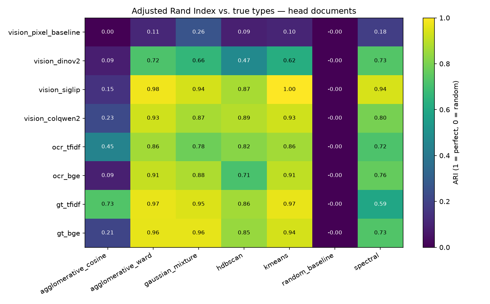
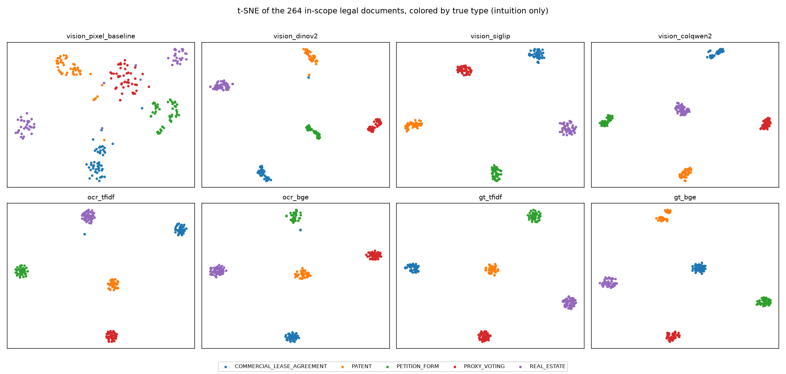

# Legal Document Intake: Vision vs. OCR Embeddings for Classification and Extraction

A pipeline that takes a scanned document from a legal review queue, decides what kind of document it is, flags anything that isn't a legal type for a human, and extracts structured JSON from the rest. Along the way it answers a research question: **do vision embeddings separate legal document types better than embeddings built from OCR text?**

Built by Team Legal 2B in the **Break Through Tech AI Studio, Fall 2026**. This is my fork of the [team repository](https://github.com/Break-Through-Tech/Legal-2B-multimodal-document-understanding).

---

## 👥 Team Members

| Name | GitHub | Contribution |
|---|---|---|
| **Santosh Pant** (me) | [@thesantoshpant](https://github.com/thesantoshpant) | Per-class extraction schemas ([#4](https://github.com/Break-Through-Tech/Legal-2B-multimodal-document-understanding/pull/4)); out-of-scope detection, confidence vs. distance ([#13](https://github.com/Break-Through-Tech/Legal-2B-multimodal-document-understanding/issues/13)) |
| Teammate | [@httpsdluc](https://github.com/httpsdluc) | Label EDA and scope policy ([#3](https://github.com/Break-Through-Tech/Legal-2B-multimodal-document-understanding/pull/3)); splits, OCR channel, vision vs. OCR comparison ([#7](https://github.com/Break-Through-Tech/Legal-2B-multimodal-document-understanding/pull/7)) |
| Teammate | [@ChinmayaSaran](https://github.com/ChinmayaSaran) | Dataset setup and vision embedding channel ([#1](https://github.com/Break-Through-Tech/Legal-2B-multimodal-document-understanding/issues/1), [#2](https://github.com/Break-Through-Tech/Legal-2B-multimodal-document-understanding/issues/2)); classifier workstream (October milestone) |
| Teammate | [@4567jw](https://github.com/4567jw) | Pytesseract OCR channel ([#5](https://github.com/Break-Through-Tech/Legal-2B-multimodal-document-understanding/issues/5)); metric selection ([#6](https://github.com/Break-Through-Tech/Legal-2B-multimodal-document-understanding/issues/6)); documentation workstream (October milestone) |

### My individual contributions

- **Per-class extraction schemas** ([`schemas/`](schemas/)). Once the classifier predicts a type, extraction needs one schema for that type, but the training documents had **27 different schemas for PATENT and 35 for PROXY_VOTING**. I wrote the merge rules ([`schemas/merge.py`](schemas/merge.py)) and a build script that produces one schema per type for 8 types (5 in scope, 3 legal-adjacent).
- **Found a ground-truth bug in the benchmark.** The ground truth uses `null` for blank fields, but the dataset's own schemas don't allow `null`. Only **40% of held-out PROXY_VOTING answers** (and 13% of FORM_1040) passed their own schema. The merged schemas allow `null` and accept **100%**, while still rejecting every other type's answers.
- **23 unit tests** for the merge rules ([`tests/test_merge.py`](tests/test_merge.py)), plus a generated report with per-field coverage ([`schemas/REPORT.md`](schemas/REPORT.md)).
- **Out-of-scope detection, October milestone (tasks 3a to 3f).** Comparing two ways to flag non-legal documents: classifier confidence thresholding vs. distance to the legal training documents, with thresholds picked on validation data and precision, recall, F1, and ROC-AUC reported on the test split. Tracked in [#13](https://github.com/Break-Through-Tech/Legal-2B-multimodal-document-understanding/issues/13).

---

## 🎯 Project Highlights

- Compared **8 embedding channels** (4 vision, 2 OCR text, 2 clean-text upper bounds) with **6 clustering algorithms** on 925 documents across 18 types.
- **SigLIP vision embeddings recovered all 18 document types perfectly** (ARI 1.00 with k-means), ahead of the best OCR-text channel (0.91).
- Built an out-of-scope detector that flags held-out non-legal types with **ROC-AUC 1.00** on every learned channel, and caught a hidden confound: two vision models partly learned "this is a photo" instead of "this is not a legal document."
- Merged dozens of per-document schemas into **one extraction schema per document type** and raised schema validity on held-out PROXY_VOTING answers from **40% to 100%**.

---

## 🏗️ Project Overview

**Connection to Break Through Tech.** This is our AI Studio challenge project, the applied half of the Break Through Tech AI program at Cornell Tech. It follows the summer Machine Learning Foundations course.

**The problem.** Law firms and in-house legal teams process huge volumes of scanned documents during due diligence, litigation, and lease review. Someone has to look at each one, decide what it is, route it, and retype the important fields. This is called intelligent document processing (IDP). Legal documents are hard because they look alike: leases, patents, petitions, and proxy forms are all dense text with headers and signature blocks.

**Why it matters.** Vision models that read document images directly, with no OCR step, are new enough that nobody knows yet whether they beat OCR on legal documents. If layout stops carrying the signal, text may matter more. We test that directly.

**Advisor and coach.** Challenge Advisor: Grace Lang. AI Studio Coach: Parth Dali. This is an independent project with a legal domain focus.

### Objectives and goals

1. Parse the dataset's labels and write down a defensible policy for which types are in scope.
2. Compare vision and OCR-text embeddings head to head, with clustering scored against the true types.
3. Train a classifier over the legal types, with a documented baseline and at least one measured improvement.
4. Flag documents that are not one of the legal types instead of forcing a label on them.
5. Extract structured JSON with a multimodal LLM and score it field by field against ground truth.
6. Deliver a reproducible, documented pipeline from document image to validated JSON.

---

## 📊 Data

**OmniAI OCR Benchmark** ([Hugging Face](https://huggingface.co/datasets/getomni-ai/ocr-benchmark)): 1,000 business document images, each with ground-truth JSON and a ground-truth transcription. MIT license, about 360 MB.

### Sample data included in this repo

You don't need to download anything to explore the processed data:

| File | What it is |
|---|---|
| [`data/documents.csv`](data/documents.csv) | One row per document (1,000 rows): cleaned label, document quality, scope, split, image size, schema id. No images or text, about 100 KB |
| [`data/splits.csv`](data/splits.csv) | The team's fixed train / val / test assignment for every document (seed 42) |
| [`schemas/classes/`](schemas/classes/) | The 8 merged extraction schemas, one JSON file per document type |
| [`results/`](results/) | Every result table and figure in this README, as CSV and PNG |

The full images download automatically the first time you run [`data/load_data.py`](data/load_data.py). See [`data/README.md`](data/README.md) for the columns and known data issues.

### Scope policy

| Scope | Types | Documents | Used for |
|---|---|---|---|
| In scope | 5 core legal types: REAL_ESTATE, COMMERCIAL_LEASE_AGREEMENT, PATENT, PETITION_FORM, PROXY_VOTING | 264 | Classifier train / val / test |
| Out of scope | 13 other common types (3 of them legal-adjacent: account statements, credit card statements, Form 1040) | 661 | Negatives for the out-of-scope detector |
| Tail | 18 rare types with fewer than 30 documents each | 75 | Held-out novelty test only, never trained on |

Full reasoning in [`docs/scope_policy.md`](docs/scope_policy.md).

### What we found in the data

- **Severe long tail.** 36 types, but 18 of them share only 75 documents and several have a single example.
- **All 75 tail documents are photos**, while almost every other document is a clean render. A detector could look good just by spotting photos, so we report results on each negative set separately.
- **Ground truth often fails its own schema.** 327 documents have `null` in fields the schema says can't be null.
- **REAL_ESTATE documents are market reports built from charts**, not deeds, so OCR recall on them is low (0.52).

---

## 🧠 Methodology

1. **Labels and splits.** Parse labels from the metadata, apply the scope policy, and build a 70 / 15 / 15 split stratified by type with seed 42. Tail documents go to test only.
2. **Embedding channels.** Encode every document 8 ways and cache the vectors:
   - Vision: a 32×32 pixel baseline, DINOv2-large, SigLIP-so400m, and ColQwen2 (a document-retrieval model that reads text in the image).
   - OCR text: Tesseract 5.5.3, then TF-IDF/SVD or `BAAI/bge-base-en-v1.5`.
   - Clean text (upper bound): the same text encoders on the ground-truth transcription.
3. **Clustering.** 6 algorithms per channel (k-means, Ward, GMM, spectral, HDBSCAN, average-link cosine), scored with ARI and NMI against the true types.
4. **Out-of-scope detection.** Score each document by its distance to the nearest in-scope training documents, pick the threshold on validation, and report precision, recall, F1, and ROC-AUC on test, separately for held-out types, legal-adjacent types, and tail photos.
5. **Extraction schemas.** Merge each type's training schemas into one, allow `null`, close objects to fields seen in training, and validate held-out ground truth with `jsonschema`.

---

## 📈 Results and Key Findings

### Vision vs. OCR text (clustering, 18 types, 925 documents)

Adjusted Rand Index against the true type. 1 is perfect, 0 is random.

| Channel | k-means | Ward | GMM | Spectral | HDBSCAN |
|---|---|---|---|---|---|
| Pixel baseline | 0.10 | 0.11 | 0.26 | 0.18 | 0.09 |
| DINOv2 | 0.62 | 0.72 | 0.66 | 0.73 | 0.47 |
| **SigLIP** | **1.00** | **0.98** | 0.94 | **0.94** | 0.87 |
| ColQwen2 | 0.93 | 0.93 | 0.87 | 0.80 | **0.89** |
| OCR + TF-IDF | 0.86 | 0.86 | 0.78 | 0.72 | 0.82 |
| OCR + bge | 0.91 | 0.91 | 0.88 | 0.76 | 0.71 |
| Clean text + TF-IDF | 0.97 | 0.97 | 0.95 | 0.59 | 0.86 |



- **Vision wins when it's the right vision model.** SigLIP reaches 1.00 and ColQwen2 0.93, both above OCR text (0.91). DINOv2, trained without text, only reaches 0.62.
- **Most of the OCR gap is OCR error.** The same text encoders on clean text reach 0.94 to 0.97.
- **The 5 legal types alone are too easy to rank channels on.** Every learned channel scores 0.98 to 1.00 there, because each legal type follows one template in this benchmark.



### Out-of-scope detection (test split)

| Channel | ROC-AUC, held-out types | ROC-AUC, tail photos | Precision | Recall | Legal photos wrongly flagged (of 4) |
|---|---|---|---|---|---|
| Pixel baseline | 0.79 | 0.87 | 0.93 | 0.97 | 4 |
| DINOv2 | 1.00 | 1.00 | 1.00 | 1.00 | 4 |
| SigLIP | 1.00 | 1.00 | 0.97 | 1.00 | 2 |
| **ColQwen2** | 1.00 | 1.00 | 1.00 | 0.97 | **0** |
| **OCR + bge** | 1.00 | 1.00 | 1.00 | 0.99 | **0** |

The headline numbers look perfect, but the last column is the real finding. **DINOv2 and SigLIP flag phone photos of legal documents as out of scope**, because all the rare tail types in this benchmark are photos, so "looks like a photo" happens to predict "not legal." ColQwen2 and OCR + bge read the text instead and flag none of them. A real intake queue will receive phone photos of leases, so we recommend **SigLIP for classification and ColQwen2 or OCR + bge for out-of-scope detection**.

### Extraction schemas (held-out documents)

| Type | Distinct training schemas | Valid against own schema | Valid against merged schema |
|---|---|---|---|
| PATENT | 27 | 100% | 100% |
| PROXY_VOTING | 35 | **40%** | **100%** |
| CREDIT_CARD_STATEMENT | 8 | 53% | 100% |
| FORM_1040 | 36 | 13% | 100% |
| Lease, petition, real estate | 1 each | 100% | 100% |

Every merged schema accepts 0% of other types' answers, so it still works as a type check. Full report: [`schemas/REPORT.md`](schemas/REPORT.md).

---

## 👩🏽‍💻 Setup and Installation

You need **Python 3.12+** and **Tesseract** (for the OCR channel only).

```bash
# 1. Clone
git clone https://github.com/thesantoshpant/legal-2b-multimodal-document-understanding.git
cd legal-2b-multimodal-document-understanding

# 2. Create an environment and install the pinned packages
python3 -m venv .venv
source .venv/bin/activate            # Windows: .venv\Scripts\activate
pip install -r requirements.txt

# 3. Install Tesseract
brew install tesseract               # macOS
# sudo apt-get install -y tesseract-ocr   # Ubuntu / Colab
```

The first data step downloads the benchmark from Hugging Face (about 360 MB, no account needed).

### Run the pipeline step by step

Run everything from the repository root.

```bash
# Data: labels, scope, splits, processed table
python data/load_data.py --summary
python data/scope.py --summary
python data/splits.py
python data/build_dataset.py

# Embeddings (cached to cache/, which is git-ignored)
python -m features.vision_embeddings   # ColQwen2 takes ~25 min on a laptop GPU
python -m features.ocr                 # ~2 min on a 14-core laptop, resumable
python -m features.text_embeddings

# Evaluate
python -m analysis.clustering          # results/clustering_comparison.csv + figures
python -m analysis.out_of_scope        # results/out_of_scope_*.csv
python -m analysis.ocr_quality         # results/ocr_quality_*.csv

# Extraction schemas, using the team split
python schemas/build_class_schemas.py --split-manifest data/splits.csv

# Tests
pytest
```

### On Google Colab

```python
!git clone https://github.com/thesantoshpant/legal-2b-multimodal-document-understanding.git
%cd legal-2b-multimodal-document-understanding
!apt-get install -y tesseract-ocr
!pip install -r requirements.txt
!python data/load_data.py --summary
```

Colab disconnects, so every embedding and OCR script writes its cache as it goes and picks up where it left off.

---

## 📓 Notebooks

| Notebook | What it shows |
|---|---|
| [`notebooks/Legal2B_Group_Notebook.ipynb`](notebooks/Legal2B_Group_Notebook.ipynb) | Start here. Loads the dataset with the shared loader and previews a document |
| [`notebooks/Label_EDA_and_Scope.ipynb`](notebooks/Label_EDA_and_Scope.ipynb) | Label parsing, missingness checks, class counts, and the scope policy, with every number in `docs/scope_policy.md` reproduced |
| [`Legal2B_Group_Notebook_embedding+OCR.ipynb`](Legal2B_Group_Notebook_embedding+OCR.ipynb) | Colab walkthrough: loads the data, then compares vision embedding models on the legal types with an OCR text channel alongside |

---

## 📚 Documentation

| Doc | Covers |
|---|---|
| [`data/README.md`](data/README.md) | Dataset columns, loader usage, known data issues |
| [`docs/scope_policy.md`](docs/scope_policy.md) | Which types are in scope and why, the long tail, the photo confound |
| [`docs/splits.md`](docs/splits.md) | Split strategy, seed, counts, and the `documents.csv` columns |
| [`docs/ocr_channel.md`](docs/ocr_channel.md) | OCR settings and OCR accuracy by type and quality |
| [`docs/embedding_comparison.md`](docs/embedding_comparison.md) | Full clustering and out-of-scope results, with caveats |
| [`schemas/README.md`](schemas/README.md) | How the schema merge works and how to run it |
| [`Challenge-Project-Overview.md`](Challenge-Project-Overview.md) | The original challenge brief |

### Code reference

| Module | Main functions |
|---|---|
| `data/load_data.py` | `build_labels()` parses labels from the metadata JSON |
| `data/scope.py` | `apply_scope_policy(labels)` adds `scope` and `is_legal_adjacent` columns |
| `data/splits.py` | `build_splits(labels, seed=42)` builds the stratified manifest; `check_splits()` validates it |
| `data/build_dataset.py` | `load_documents()` loads the processed table; `decode_markdown(raw)` decodes ground-truth text |
| `features/vision_embeddings.py` | `embed_all(name)` embeds every image with one vision model and caches it |
| `features/ocr.py` | `auto_rotate(image)`, `load_ocr_text()` for cached Tesseract output |
| `features/text_embeddings.py` | `embed_tfidf(texts, train_mask)`, `embed_bge(texts)` |
| `analysis/channels.py` | `load_channels(names)` loads cached embeddings for comparison |
| `analysis/clustering.py` | `evaluate_population(X, y)` runs every algorithm and scores it |
| `analysis/out_of_scope.py` | `novelty_scores(X, reference)`, `best_threshold(scores, is_oos)` |
| `schemas/merge.py` | `merge_schemas(schemas)` returns one schema and any conflicts; `allow_null(schema)` |
| `schemas/build_class_schemas.py` | `field_coverage(schema, truths)`, `make_validator(schema)` |

---

## 🚀 Next Steps

**Limitations right now**
- One seed and one split. Differences of a few hundredths in ARI are within noise.
- The out-of-scope test set has 39 legal documents, so one document moves precision or recall by about 0.03.
- Each legal type follows one template in this benchmark. Real legal documents vary much more, so these numbers are an upper bound.
- PATENT, ACCOUNT_STATEMENT, and FORM_1040 schemas have no required fields, so an empty `{}` passes them.
- English only, and no layout model, so OCR breaks table columns.

**December plan**
- Finish the out-of-scope comparison (confidence vs. distance) and an error analysis by document quality.
- Run multimodal LLM extraction (a ~3B Qwen-VL model on a free Colab T4) with the merged schemas, and score it field by field.
- Wire the stages into one end-to-end pipeline, and try the stretch goal: an agent that classifies, flags, routes, and validates.

---

## 📝 License

The dataset is MIT licensed by OmniAI. The code license will be set with our Challenge Advisor before the final release.

## 🙏 Acknowledgements

Thanks to our Challenge Advisor **Grace Lang**, our AI Studio Coach **Parth Dali**, and the **Break Through Tech AI** team at Cornell Tech. Dataset by [OmniAI](https://github.com/getomni-ai/benchmark).
